# SOGI-PLL for a Single-Phase Grid-Connected Inverter

Design, tuning and stress testing of a **Second-Order Generalized Integrator Phase-Locked Loop (SOGI-PLL)** that synchronizes a single-phase, two-level grid-connected inverter with an L filter to the grid, plus the PI current controller that injects current in phase with it. Built from scratch in PLECS, in both continuous and discrete time.

Solo project for the **Control of Energy Conversion Systems** course at Warsaw University of Technology (2026).

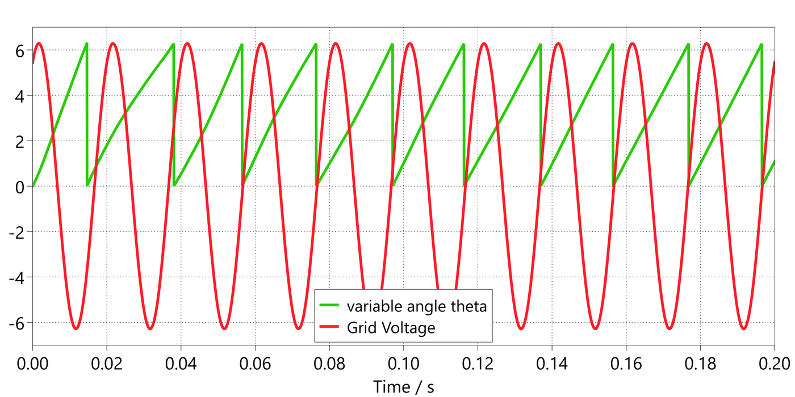

## Results at a glance

| | |
|---|---|
| Lock-on time after tuning | under 0.1 s |
| Recovery from a π/3 grid phase jump | PLL error back to zero in ≈ 50 ms; injected current back in phase within about one grid cycle |
| Final tuning | SOGI gain k = √2, PLL PI: Kp = 1.1, Ki = 50 |
| Power modes | active power (Vd = 0) and reactive power (Vq = 0) |
| Discrete implementation | 10 kHz sampling (5 kHz showed visible discretization error) |
| Known limitation | standard SOGI cannot reject a DC offset in the grid voltage (shown and explained below) |

## The problem

A grid-connected inverter has to know the grid's phase angle at every instant to inject current in sync with it. Three-phase systems get an orthogonal (αβ) signal pair for free from a Clarke transform. A **single-phase system only has one voltage**, so the 90° shifted partner signal has to be generated.

The SOGI solves this. It is a resonant filter built from two integrators that, from the one measured voltage, produces:

- **Vα**, an in-phase, filtered copy of the grid voltage
- **Vβ**, the same signal shifted by exactly 90°

```
D(s) = Vα / V = k·ω·s / (s² + k·ω·s + ω²)          (band-pass)
Q(s) = Vβ / V = k·ω²  / (s² + k·ω·s + ω²)          (low-pass, 90° behind)
```

A Park transform turns Vα and Vβ into Vd and Vq in a frame rotating at the estimated angle θ′. A PI controller (the loop filter) adjusts the estimated frequency until the chosen axis is zero, and an integrator (the VCO) turns that frequency into θ′. Phase synchronization becomes a simple DC regulation problem.

## The system

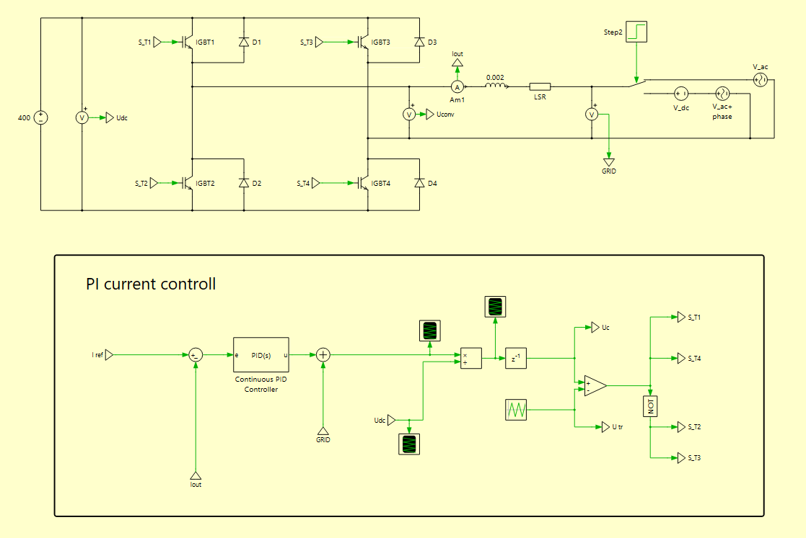

- **Power stage:** single-phase H-bridge (4 IGBTs with antiparallel diodes), 400 V DC link, L filter of 2 mH with 0.01 Ω series resistance
- **Grid:** 230 V RMS (325 V peak), 50 Hz
- **Control:** SOGI orthogonal signal generator → Park transform → PI loop filter → VCO, feeding a PI current controller and a PWM modulator

| SOGI and PLL blocks | PI current controller |
|---|---|
| 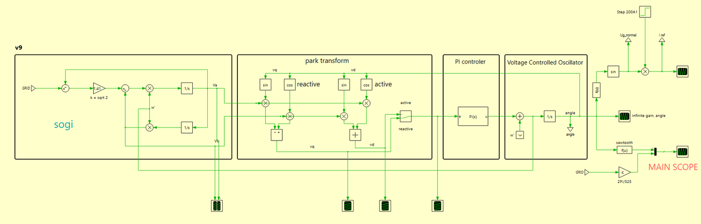 | 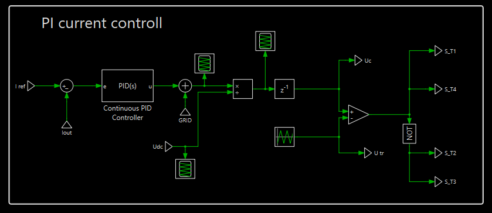 |

## Design decisions

### Locking for active power instead of reactive

By the usual cosine convention, driving Vq to zero makes the PLL lock 90° away from a sine-based grid voltage, which means injecting purely reactive power. Rather than patching that with an artificial delay block, I changed the control target inside the Park transform to **Vd = 0**, which removes the 90° offset and aligns θ′ with the grid for active power. Switching the target back to Vq = 0 gives reactive power on demand.

| Active power mode (Vd = 0) | Reactive power mode (Vq = 0), shifted by π/2 |
|---|---|
| 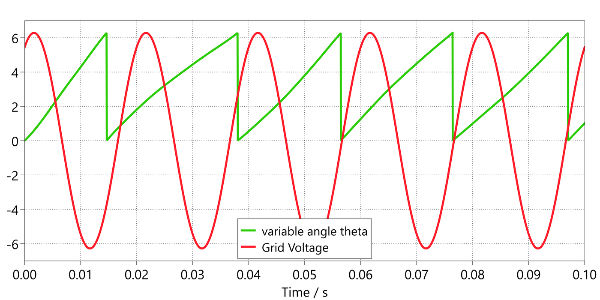 | 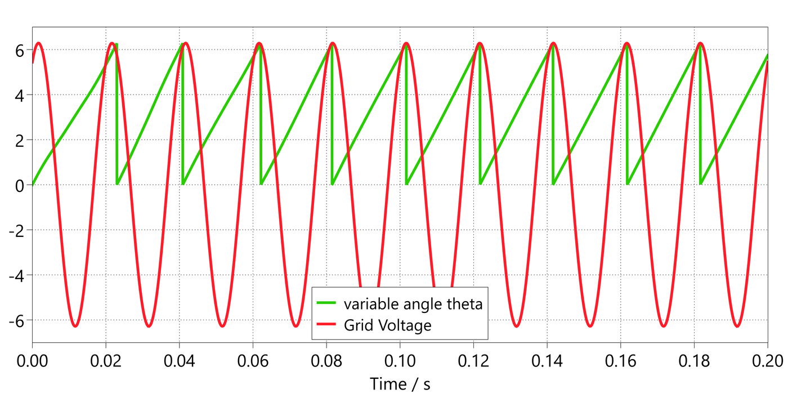 |

### Tuning by parameter sweeps

- **SOGI gain k:** sets the filter bandwidth. Low k filters noise well but responds slowly, high k is fast but noisy. I used the standard optimum **k = √2 ≈ 1.41**.
- **Proportional gain Kp:** swept from 0.3 (sluggish, underdamped) to 1.3 (aggressive oscillation, edge of instability). **Kp = 1.1** gave much faster settling than the 0.4 baseline while staying well damped.
- **Integral gain Ki:** swept from 1 (leaves residual steady-state error) to 57 (loop breaks down). **Ki = 50** gives the largest initial spike but the fastest return to steady state without going unstable.

| Kp sweep (Vq transient) | Ki sweep (Vq transient) |
|---|---|
| 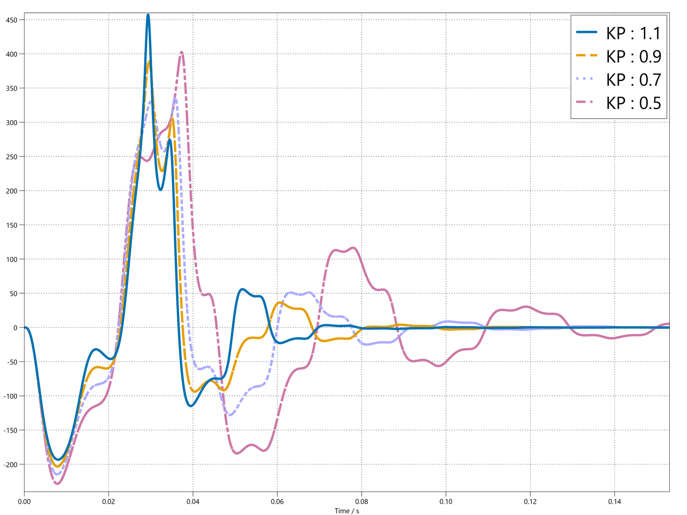 | 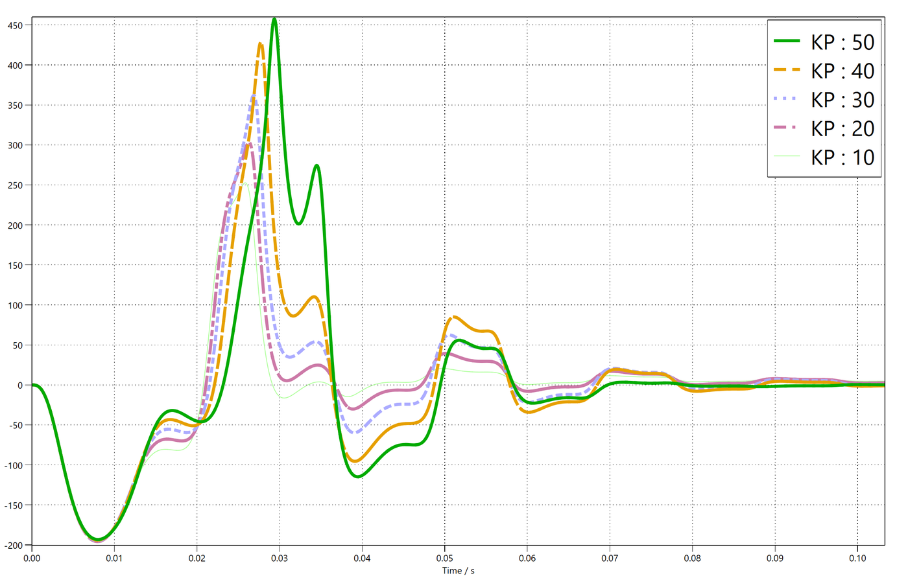 |

## Current control

The locked angle θ′ generates a sinusoidal current reference. A PI controller compares it with the measured inductor current and sets the duty cycle for the IGBT gates through PWM. In short, the PLL decides *when* to inject current and the current controller makes sure the *right amount* flows.

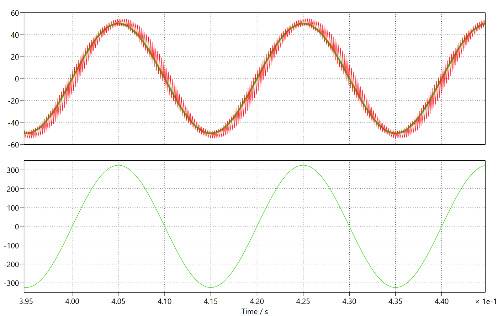

## Stress tests

### π/3 grid phase jump at t = 0.5 s

Simulates a severe grid fault. Vq spikes, then oscillates with decreasing amplitude, and the PLL is fully re-locked in about **50 ms**, with a peak no bigger than the normal startup transient. Cycle by cycle, θ′ misses the first zero crossing, corrects on the second, and is clean again by the fourth.

| Vq after the phase jump | θ′ re-locking to the grid |
|---|---|
| 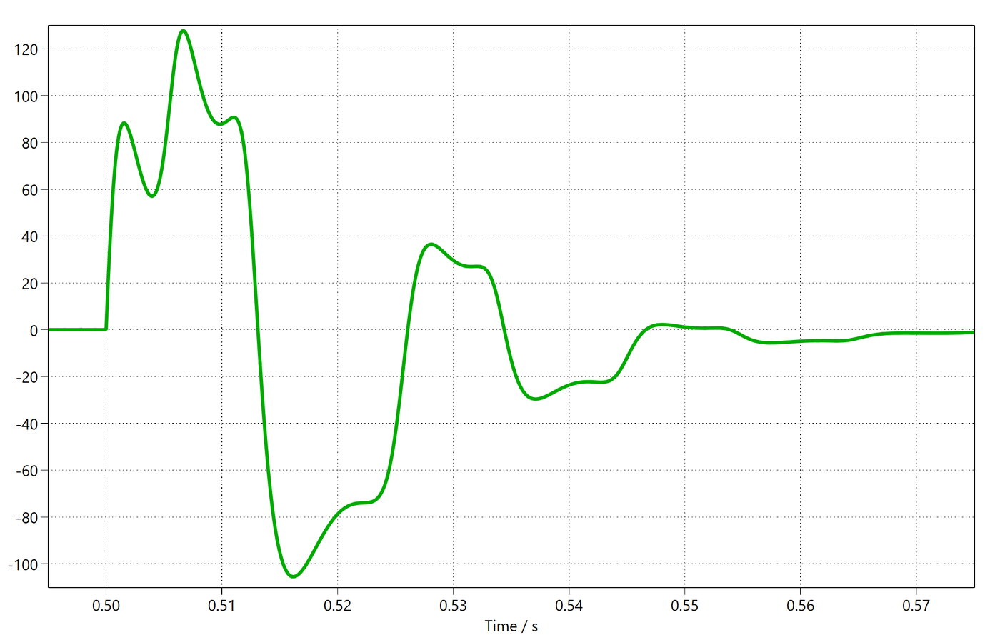 | 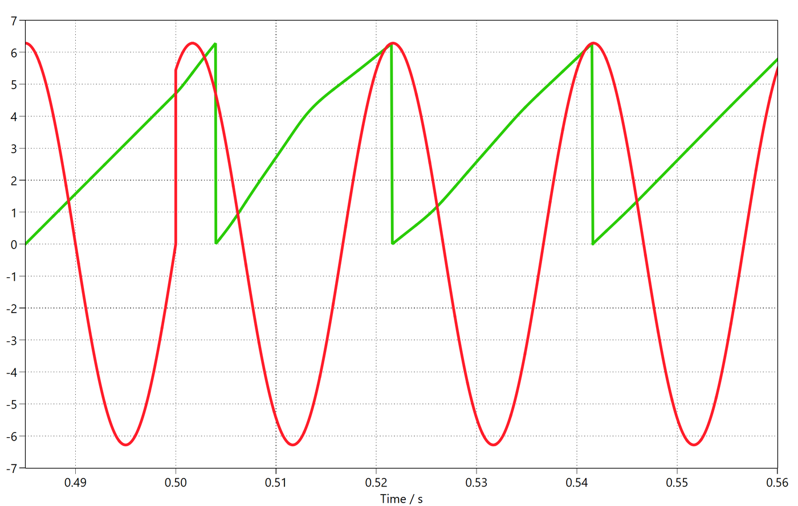 |

### DC offset injection at t = 0.5 s

This test exposes the standard SOGI's known weakness. A few volts of DC on the grid signal makes the ideal integrators accumulate error without bound, which shifts Vα and Vβ off-center and corrupts the phase estimate. Vq never settles; it is pushed into a permanent oscillation.

| θ′ with a DC offset | Vq stuck oscillating |
|---|---|
| 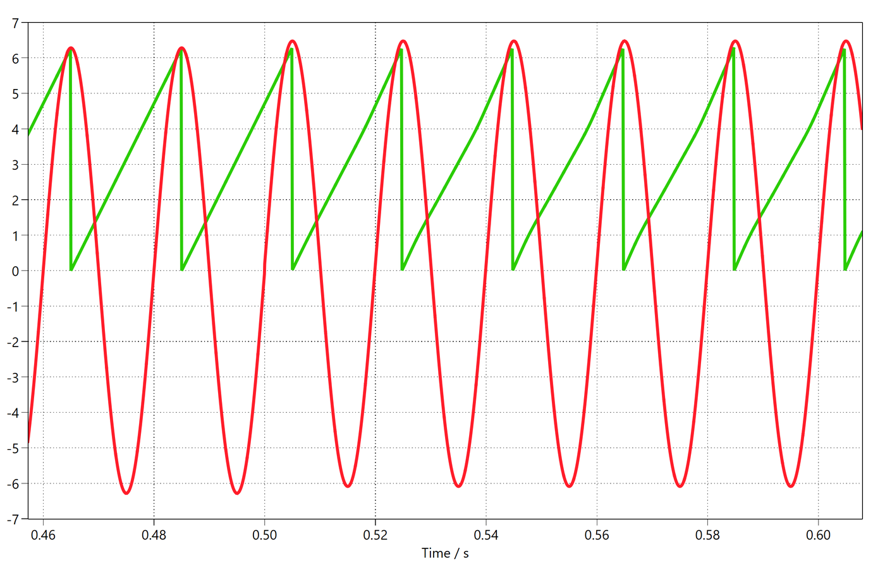 | 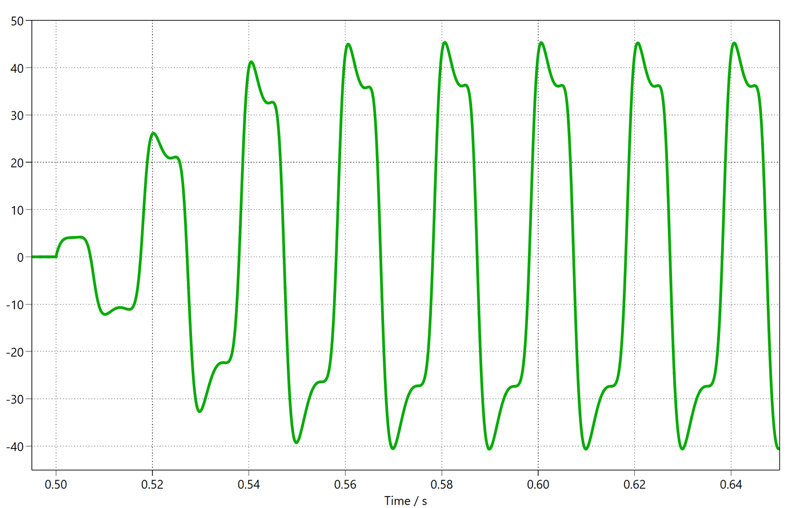 |

The fix is a modified SOGI that replaces the low-pass behaviour of the quadrature path with a band-pass filter so DC never reaches the integrators. It was outside this project's scope, so I documented the limitation instead.

## Continuous to discrete time

A real controller runs at a fixed sampling rate, so the continuous integrators have to become discrete approximations. At **5 kHz** the reconstructed signals were visibly jagged and the phase tracking lagged. Raising the rate to **10 kHz** gave smooth signals and clean tracking, so 10 kHz became the final standard.

| 5 kHz | 10 kHz |
|---|---|
| 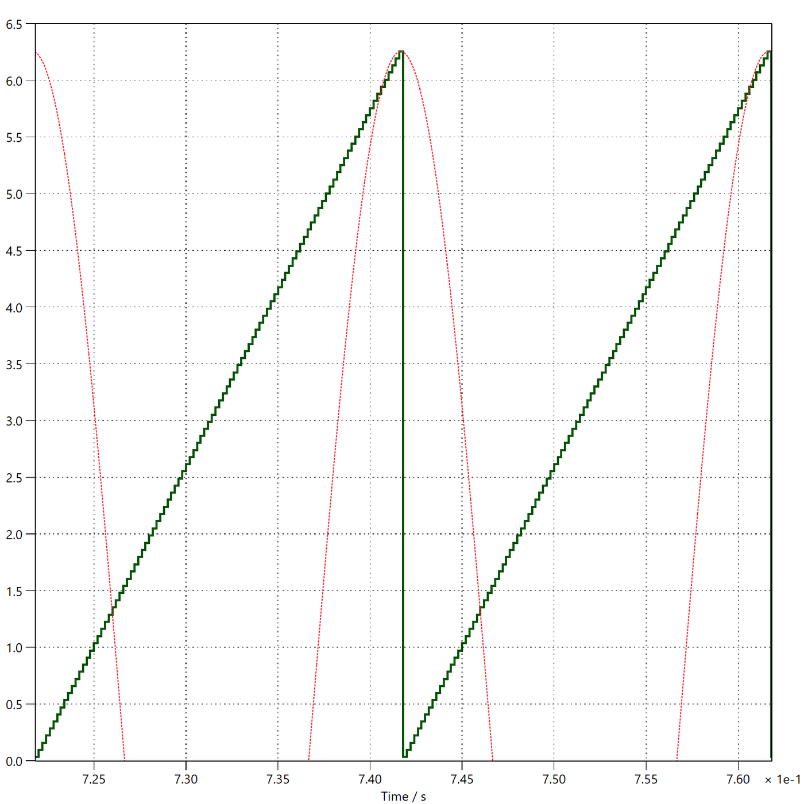 | 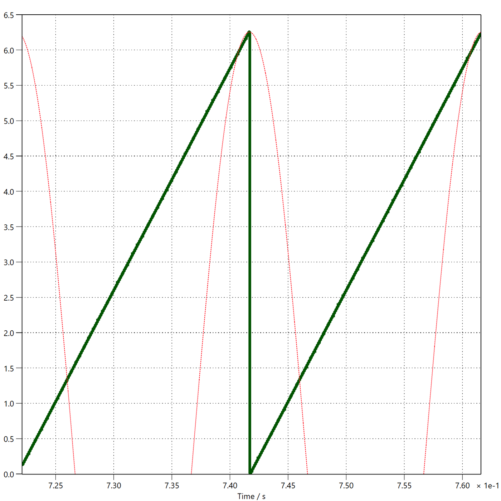 |

## Next steps

- Implement the DC-offset-rejecting SOGI variant and repeat the DC injection test
- Add frequency adaptation (feed the estimated frequency back into the SOGI) so it stays tuned when the grid drifts away from 50 Hz
- Test against harmonics and voltage sags, and move from the L filter to an LCL filter

## Repository contents

```
plecs/sogi_pll_continuous.plecs   Continuous-time model
plecs/sogi_pll_discrete.plecs     Discrete-time model
docs/sogi_pll_report.pdf          Full project report (LaTeX)
images/                           Schematics and simulation results
```

**Run it:** open a model in PLECS Standalone 5.0 or newer (the files are saved in the 5.0 format) and start the simulation (1 s run). In the discrete model, the sampling frequency is set by `Ts` under Simulation → Simulation Parameters → Initialization. The file is saved with `Ts=5000` (5 kHz); set `Ts=10000` to reproduce the final 10 kHz results.

## References

1. imperix, *Implementation of SOGI-PLL for Single-Phase PV Inverter*, [imperix.com/doc/implementation/sogi-pll](https://imperix.com/doc/implementation/sogi-pll)
2. R. Teodorescu, M. Liserre, P. Rodríguez, *Grid Converters for Photovoltaic and Wind Power Systems*, Wiley, 2011
3. IEEE Xplore, documents [1711988](https://ieeexplore.ieee.org/document/1711988) and [9369398](https://ieeexplore.ieee.org/abstract/document/9369398)

## Tools

PLECS (continuous and discrete-time simulation), LaTeX for the report.
